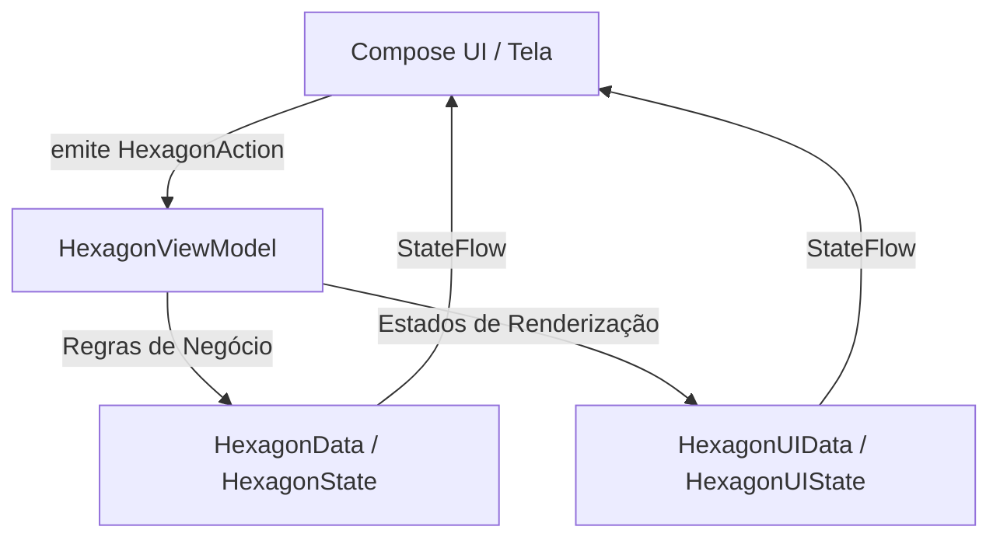

# 🔷 HexagonApp — Trajetória & Engenharia Android

> 🚀 **Um projeto prático focado na minha evolução contínua como Desenvolvedor Android.**

O **HexagonApp** é um projeto laboratório e vitrine técnica desenvolvido 100% em **Kotlin**, projetado para aplicar e consolidar os conceitos mais modernos de **Engenharia de Software Android**: **Clean Architecture**, **Modularização Multi-Módulo Gradle**, **Injeção de Dependências com Koin**, **UI Declarativa com Jetpack Compose** e o padrão de arquitetura proprietário **Hexagon MVI** (Unidirectional Data Flow).

---

## 📌 Status do Projeto & Melhoria Contínua

> 🛠️ **Em Constante Evolução:** Este repositório reflete minha jornada de aprendizado e aprimoramento técnico diário. Novas funcionalidades, refatorações de código, otimizações de performance e expansão de testes são aplicadas continuamente para alinhar o app aos padrões de nível sênior do mercado.

---

## 🌟 Visão de Engenharia & Evolução Técnica

Este projeto representa marcos significativos da minha maturidade como desenvolvedor:

- **Domínio da Stack Nativa Moderna**: Substituição do modelo tradicional de Views (XML) e Fragments por **100% Jetpack Compose**, **Navigation 3** com suporte a **Kotlinx Serialization** e estado reativo com **Coroutines & Flow**.
- **Pensamento Modular & Escalabilidade**: Organização do código em 7 subprojetos Gradle (`:app`, `:appCore:data`, `:appCore:domain`, `:appCore:di`, `:appCore:presentation`, `:localData`), garantindo isolamento de responsabilidades, reuso de código e build incremental rápido.
- **Aplicações dos Princípios S.O.L.I.D.**: Busca constante pelo desacoplamento de classes, inversão de controle via Koin DI e responsabilidade única em componentes de UI e lógica de negócios.
- **Cultura de Qualidade & Testabilidade**: Integração de **Detekt** e **Ktlint** para análise estática de código, acompanhada de testes unitários (**JUnit4 + MockK**) e testes de interface no Compose (**Compose Test Rule**).

---

## 🏗️ Arquitetura Modular do Projeto

O projeto é estruturado em subprojetos Gradle fortemente desacoplados:

```
HexagonApp/
 ├── 📱 app/                      # Camada de Aplicação (Features, UI & Entry Point)
 ├── 🧩 appCore/                  # Framework de Infraestrutura & Reuso (Agregador)
 │    ├── 🌐 data/               # Rede, Retrofit, Interceptors, Broadcast Receivers, Monitores
 │    ├── 🎯 domain/             # Casos de Uso (UseCases), Interfaces & Regras de Negócio Puras
 │    ├── 💉 di/                 # Registro Centralizado de Injeção de Dependências (Koin)
 │    └── 🎨 presentation/       # Componentes Base de UI, Navigation 3, Theme & ViewModels Base
 └── 💾 localData/                # Camada de Persistência Local (Room Database, DAOs & Sources)
```

### 🔍 Detalhamento das Camadas

#### `📱 :app` (Aplicação & Features)
- **Features Modularizadas em Presentation**:
  - `actives`: Listagem reativa e remoção de perfis ativos.
  - `inactives`: Gerenciamento de perfis inativos.
  - `form`: Formulário completo com foto de perfil, validações dinâmicas de CPF/Data, DatePicker e diálogos de confirmação.
  - `devProfile`: Integração remota com a API REST do GitHub para busca e exibição interativa do perfil do desenvolvedor e repositórios.
  - `main`: Container e orquestrador principal de Dark Mode, conectividade, nível de bateria e navegação.

#### `🧩 :appCore` (Framework Core de Infraestrutura)
- **`:appCore:domain`**: Contratos e abstrações dos Use Cases (ex: `BatteryMonitorUseCase`, `NotificationUseCase`, `CheckNotificationPermissionUseCase`).
- **`:appCore:data`**:
  - **Rede Resiliente**: Cliente `HexagonRetrofit` com `RemoteSource` para parsing seguro e interceptores dedicados (`LoggingInterceptor`, `ErrorInterceptor`, `NetworkStatusInterceptor`). Mapeamento tipado de erros HTTP (`NotFoundException`, `ForbiddenException`, `ServerException`).
  - **Monitores do Sistema**: Receivers assíncronos de nivel de bateria (`BatteryMonitorUseCase`) e callback em tempo real de estado de rede via `NetworkMonitor`.
  - **Notificações**: Configuração dinâmica de canais de notificação para Android 8.0+.
- **`:appCore:presentation`**:
  - **Arquitetura Base**: Contêineres de ViewModel (`HexagonViewModel`, `HexagonData`, `HexagonUIData`, `HexagonState`, `HexagonUIState`).
  - **Navegação 3**: Gerenciamento de rotas e backstack desacoplado via `HexagonScreenInnerNavigator`.
  - **Componentização por Seções**: Separação de componentes visuais em 4 papéis claros (`HexagonSection`, `HexagonSectionView`, `HexagonSectionMapper`, `HexagonSectionRender`).
- **`:appCore:di`**: Configurações centrais do ecossistema Koin.

#### `💾 :localData` (Persistência com Room)
- **Banco de Dados**: Configuração do `AppDatabase` com **Room + KSP**.
- **Entidades e DAOs**: Tabela `PersonalProfile` e `Settings`, abstraídas por DataSources e Repositórios locais.

---

## 🏛️ Padrão de Arquitetura de Apresentação (Hexagon MVI)

O fluxo de dados da camada de apresentação segue o padrão de **Unidirectional Data Flow (UDF)**:



1. **`HexagonAction`**: Eventos imutáveis disparados pelas interações do usuário.
2. **`HexagonViewModel`**: Processa a intenção do usuário e gerencia a atualização de dois fluxos concorrentes:
   - **`HexagonData`**: Estado dos dados de negócio.
   - **`HexagonUIData`**: Estado de renderização da UI (Loading, Shimmer, Diálogos, Erros, Dark Theme).
3. **Seções Modulares (Section Pattern)**: Cada tela é decomposta em componentes isolados (ex: `UserSection`, `RepositoriesSection`, `FormSection`), facilitando manutenção e testes de visualização.

---

## 🛠️ Conceitos Android & Competências Demonstradas

- **Jetpack Compose & Material Design 3**: UI moderna declarativa, componentes adaptativos (`androidx.compose.material3.adaptive`) e troca dinâmica de temas (Dark/Light Mode).
- **Jetpack Navigation 3**: Navegação moderna fortemente tipada com `kotlinx.serialization`.
- **Programação Reativa**: **Kotlin Coroutines & Flow** (`StateFlow`, `collectAsStateWithLifecycle`) para consumo seguro no ciclo de vida Android.
- **Injeção de Dependências**: **Koin** com escopos específicos por Activity/Screen (`KoinScopeComponent`).
- **Persistência de Dados**: **Room Database** assíncrono com suporte a Coroutines e processamento via **KSP**.
- **Integração REST & Tratamento de Erros**: **Retrofit 2 + OkHttp 3**, serialização Gson, interceptores de requisição/resposta e exceções HTTP tipadas.
- **Integração com Hardware & Sistema Operacional**:
  - **Broadcast Receivers**: Monitoramento de nível de bateria em tempo real (`ACTION_BATTERY_LOW`, `ACTION_BATTERY_OKAY`).
  - **Network Capabilities**: Monitor de status de internet via `ConnectivityManager`.
  - **Notificações**: Gestão de canais e emissão de alertas do sistema.
  - **Permissões em Runtime**: Fluxo seguro de solicitação da permissão de notificação (`POST_NOTIFICATIONS`) no Android 13+.
  - **Splash Screen API**: Integração nativa com `core-splashscreen`.

---

## 📚 Bibliotecas e Stack Tecnológica

| Categoria | Tecnologia / Library | Versão | Aplicação no Projeto |
| :--- | :--- | :--- | :--- |
| **Linguagem / Core** | `Kotlin` | `2.4.21` | Base do desenvolvimento nativo Android |
| **Build System** | `AGP` / `Gradle` | `9.4.1` | Gerenciamento e compilação do projeto multi-módulo |
| **UI Framework** | `Jetpack Compose BOM` | `2026.09.00` | Construção de interfaces declarativas |
| **Design System** | `Material Design 3` | `1.4.0` | Componentes de UI padronizados |
| **Layout Adaptativo**| `androidx.compose.material3.adaptive` | `1.3.0` | Adaptação para múltiplos formatos de tela |
| **Navegação** | `Jetpack Navigation 3` | `1.2.0` | Gerenciamento moderno de rotas tipadas |
| **DI** | `Koin` | `4.2.2` | Injeção de dependências em todo o app |
| **Persistência** | `Room` | `2.8.5` | Banco de dados local SQLite |
| **Processador** | `KSP` | `2.3.6` | Kotlin Symbol Processing para Room e Koin |
| **HTTP Client** | `Retrofit` / `OkHttp` | `3.0.0` / `5.5.1` | Comunicação com APIs REST e interceptores |
| **Carregamento de Imagens** | `Coil 3` | `3.6.3` | Renderização assíncrona de imagens em Compose |
| **Animações** | `Lottie Compose` | `6.7.1` | Animações vetoriais em Compose |
| **Utilidades** | `ZXing` | `3.5.4` | Gerador de QR Code |
| **Testes** | `JUnit4`, `MockK`, `Koin Test` | Recentes | Testes unitários e de integração de ViewModel/Repository |
| **Qualidade de Código** | `KtLint` / `Detekt` | `14.2.0` / `2.0.0` | Padronização de código e análise estática |

---

## 🧪 Qualidade de Código & Testes

A busca por confiabilidade é refletida na estrutura de testes e ferramentas de análise estática:

- **Testes Unitários (`app/src/test`)**: Testes de Repositórios, Fontes de Dados Remotas, Mappers e Use Cases utilizando `MockK` e `CoroutinesTest`.
- **Testes de Instrumentação (`app/src/androidTest`)**: Testes de UI e navegação com Compose Test Rule ([FormScreenTest.kt](app/src/androidTest/java/br/com/leonardo/hexagonapp/ui/FormScreenTest.kt) e [NavigationTest.kt](app/src/androidTest/java/br/com/leonardo/hexagonapp/ui/NavigationTest.kt)).
- **Análise Estática**: Padronização de código contínua com **Detekt** e **Ktlint**.

---

## 📈 Próximos Passos & Visão Crítica de Arquitetura

Como parte da minha visão autocrítica de engenharia de software, mapeei os seguintes pontos de refatoração para as próximas fases do projeto:

1. 🎯 **Refinamento do Módulo `:localData`**: Isolar totalmente as entidades do Room (`@Entity`) dos modelos de domínio, criando um mapeamento estrito entre `Entity` ↔ `DomainModel`.
2. 🎯 **Desacoplamento de UseCases**: Garantir que todos os UseCases puros estejam alocados exclusivamente na camada de Domínio (`:appCore:domain`), mantendo o princípio de Clean Architecture impecável.
3. 🎯 **Consolidação de Estado MVI**: Evoluir o contêiner de ViewModel para uma representação de estado imutável unificada via Sealed Interfaces no Compose.
4. 🎯 **Ampliação de Cobertura de Testes**: Expandir a suíte de testes automatizados para cobrir 100% das regras de negócio dos ViewModels.

---

## 🚀 Como Executar o Projeto

### Pré-requisitos
- **Android Studio** Ladybug (2024.2.1) ou superior.
- **JDK**: Java 17 ou Java 21 configurado no IDE.
- **SDK Android**: `compileSdk = 37`, `minSdk = 28`, `targetSdk = 35`.

### Passos
1. Clone este repositório:
   ```bash
   git clone https://github.com/seu-usuario/HexagonApp.git
   ```
2. Abra o projeto no **Android Studio**.
3. Aguarde a sincronização do Gradle (**Gradle Sync**).
4. Execute o módulo `:app` em um dispositivo físico ou emulador com Android 9.0 (API 28) ou superior.

---

## 📄 Licença e Considerações

Projeto desenvolvido com fins de estudo, aprimoramento técnico e demonstração de engenharia Android nativa. Sinta-se à vontade para explorar o código!
